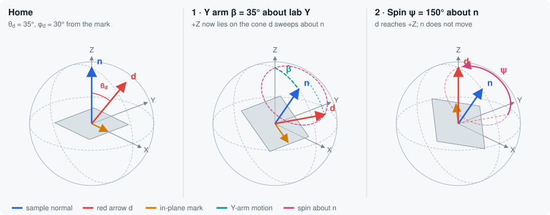

# threeDrotation

This project has two 3D tools that help you understand rotations. Each tool is one HTML file that runs in a browser. The files use [three.js](https://threejs.org/) r147 from a CDN. You do not need to build the files.

| File | Description |
| --- | --- |
| [goniometer.html](goniometer.html) | **Goniometer Normal Viewer.** Turn the motors of a sample goniometer and see the direction of the sample surface normal. |
| [index.html](index.html) | **Rotation Aiming Bench.** Turn a body with Euler angles until its nose points at a target. The tool compares Euler interpolation, slerp and closed-loop tracking. It also shows gimbal lock. |

## Running

Open one of the HTML files in a modern browser (Chrome, Edge, Firefox or Safari). The first load needs internet access for three.js and the Google Fonts. To serve the files from your computer, do these steps:

```sh
python -m http.server 8000
# then open http://localhost:8000/goniometer.html
```

In the 3D view:

- Drag to turn the camera around the scene.
- Scroll to zoom.
- Right-drag to move the camera sideways.

Both pages use the light or dark theme of your system.

## Conventions (both pages)

- The lab frame is right-handed. **Z points up**.
- Positive angles follow the **right-hand rule**. Point your thumb along the axis. Your fingers then curl in the positive direction.
- The pages show a direction as a unit vector, as a polar angle θ from +Z, and as an azimuth φ from +X toward +Y.

---

## Goniometer Normal Viewer (`goniometer.html`)

The page models a stack of three rotary motors. The list starts at the lab:

1. **Base**: turns the full assembly about lab Z (±180°).
2. **Y arm**: sits on the base and tilts about its Y axis (±90°). When the base is at 0, this axis is lab Y.
3. **Spin**: sits on the Y arm and turns the sample about the **sample normal** (±180°).

The sample orientation is:

```text
R = R_Z(Base) · R_Y(Y arm) · R_n(Spin) · T        (base motor first)
n = R · ẑ = R_Z(Base) · R_Y(Y arm) · n_s
```

`T` is the mount tilt. It turns ẑ onto `n_s`, the sample normal in the Y-arm frame. With no mount offset, `T` is the identity and `n_s` is +Z. The spin axis is `n_s`, thus **the spin motor does not move n**. The spin motor turns the in-plane mark about n. It also turns all other items that are attached to the sample.

### Features

- **Motors.** Each motor card has a slider and a number field. Open **Axis setup** to do these changes:
  - Change the name of the motor.
  - Change the travel limits.
  - Flip the sign of the motor to agree with the direction of your controller.
  - Change the axis vector (Base and Y arm only). The spin axis is always the sample normal, thus you cannot edit it.

  Push **Home all motors** to move all motors to 0.
- **Normal readout.** The readout shows the unit vector n, the polar angle θ, the azimuth φ and the direction of the in-plane mark. It also shows the current lab direction of each motor axis. With the default axes, the readout also shows the closed-form equation. With no mount offset, the equation is:
  n = (cos Base · sin Y, sin Base · sin Y, cos Y). Thus θ = |Y arm|, and φ = Base (or Base + 180° when the Y arm angle is negative).
- **Sample mount offset.** A miscut or a wedge tilts the normal away from the Z direction of the Y arm. Set the tilt angle and the azimuth of the tilt. The spin motor always turns about the tilted normal.
- **Unit sphere grid.** The normal n is a unit vector. Thus, its tip is on the unit sphere. The sphere has grid lines at each **10°** of latitude and longitude. The lines at each 30° are stronger, and the equator is the strongest. This helps you read angles quickly. (The page draws the sphere at a fixed scene radius. This radius is equal to length 1.)
- **Red arrows d and e.** The scene has three arrows. The motors control the blue normal n. Each red arrow has its own angle sliders.
  - **d** is a unit vector that starts at the origin. Thus, its tip is on the unit sphere, the same as the tip of n.
  - **e** starts at the tip of d and is always **perpendicular to d**. Thus, e is tangent to the unit sphere at the tip of d. You can set the length of e from 0.1 to 0.95. The length is always less than 1.
  - Set d with a polar angle θ_d and an azimuth φ_d. Select the frame for these angles:
    - **Sample frame** (default). The two arrows are attached to the sample. θ_d starts at n. φ_d goes around n and starts at the in-plane mark. When a motor turns (the spin motor also), the two arrows move with the sample.
    - **Lab frame.** The two arrows stay fixed in the lab. θ_d starts at +Z, and φ_d starts at +X. The motors move n, but they do not move d or e.
  - Set e with one angle ψ_e. This angle turns e about d: e = cos ψ_e · ê_θ + sin ψ_e · ê_φ.
    - At ψ_e = 0, e points in the direction that the tip of d moves when θ_d increases.
    - At ψ_e = 90°, e points in the direction that the tip of d moves when φ_d increases.
  - When you change the frame, the two arrows stay in the same position. The page calculates their angles again in the new frame.
  - Push **Align d with n** to point d along the current normal.
  - The readout shows these values:
    - d and e in lab coordinates.
    - The angles n ↔ d and d ↔ e.
    - The position of the tip of e, d + L·e, and its distance from the origin.
- **Per-motor paths.** Colored curves on the sphere show the path of n when only one motor turns (Base or Y arm). Each curve is solid in the travel limits of the motor, and dashed outside them. The spin motor has no curve, because it does not move n.
- **Trace.** The page records the path of the tip of n when you move the motors.
- **Snapshot.** Push **Save snapshot (PNG + TXT)** to download two files with the same name: `<prefix>_YYYY-MM-DD_HH-MM-SS`.
  - **PNG:** an image of the 3D view. A caption in the corner shows θ and φ of the normal, all motor angles and the red-arrow settings.
  - **TXT:** the full configuration. The file contains these items:
    - The angle, axis and limits of each motor.
    - The mount offset.
    - n, with its θ and φ.
    - The in-plane mark.
    - d and e in lab coordinates.
    - The camera position.
  - The last line of the TXT file starts with `JSON`. This line has the same values (and the camera view) in a format that a computer can read. The file stores the spin motor with `"axis": "normal"` and its sign.
  - When you save for the first time, the browser can ask for permission to download more than one file.
- **Load snapshot.** To load a snapshot, push **Load snapshot (TXT)**, or drop a saved TXT file on the 3D view. The page reads the `JSON` line and sets these items again:
  - The angle and limits of each motor.
  - The Base and Y-arm axes.
  - The mount offset.
  - The two red arrows and their frame.
  - The camera.

  The page ignores all other lines. Thus, you can add notes to the file. Do not change the `JSON` line.
  - The page can also load older snapshots. It finds the Base and the Y arm by name. An old **Stage** motor (which turned about the Z axis of the arm) becomes the spin motor. With no mount offset, Stage and Spin are the same rotation.
  - The page ignores an old **X arm**. If the X arm angle was not 0, the page shows a warning. The normal and the arrows can then be different from the original snapshot.

### Derivation: turn the red arrow d onto the +Z axis

**Problem.** In the sample frame, the red arrow d has the tilt θ_d and the azimuth φ_d. Find the two rotations that turn d onto lab +Z:

1. A rotation about the **lab Y axis** (the Y arm).
2. A rotation about the **z axis of the sample**, which is its normal (the spin motor).

The base stays at 0. It is not part of the solution.

**Setup.** Use the default **sample frame** with no mount offset. At home (all motors at 0), the sample frame and the lab frame are the same: x is the in-plane mark, and z is the normal n. The arrow is:

$$
\mathbf{d}_s = \begin{pmatrix} \sin\theta_d \cos\varphi_d \\ \sin\theta_d \sin\varphi_d \\ \cos\theta_d \end{pmatrix}.
$$

The page uses right-handed rotations. The rotations about the lab axes are:

$$
R_Y(\beta) = \begin{pmatrix} \cos\beta & 0 & \sin\beta \\ 0 & 1 & 0 \\ -\sin\beta & 0 & \cos\beta \end{pmatrix},\qquad
R_Z(\psi) = \begin{pmatrix} \cos\psi & -\sin\psi & 0 \\ \sin\psi & \cos\psi & 0 \\ 0 & 0 & 1 \end{pmatrix}.
$$

$R_{\mathbf{n}}(\psi)$ is a rotation by ψ about a unit axis n.

#### Step 1: the geometric answer (shortest rotation)

The shortest rotation from d to ẑ turns about the axis that is perpendicular to the two vectors. The rotation angle is the angle between the two vectors:

$$
\mathbf{k} = \frac{\mathbf{d}_s \times \hat{\mathbf{z}}}{\lVert \mathbf{d}_s \times \hat{\mathbf{z}} \rVert} = \begin{pmatrix} \sin\varphi_d \\ -\cos\varphi_d \\ 0 \end{pmatrix},
\qquad
\cos\omega = \mathbf{d}_s \cdot \hat{\mathbf{z}} = \cos\theta_d \;\Rightarrow\; \omega = \theta_d .
$$

The axis k is horizontal, at the azimuth φ_d − 90°. Rodrigues' formula gives the rotation matrix. $K$ is the cross-product matrix of k:

$$
R_{\min} = I + \sin\theta_d\, K + (1 - \cos\theta_d)\, K^2 .
$$

The Y arm tilts about only one fixed axis (lab Y). Thus, the Y arm alone cannot turn about k. Step 2 adds the spin about the sample normal to solve this problem.

#### Step 2: first the Y arm, then the spin about the sample z axis

**Rotation 1: the Y arm turns by β about lab Y.** The full sample tilts. The normal and the arrow move to:

$$
\mathbf{n} = R_Y(\beta)\,\hat{\mathbf{z}} = \begin{pmatrix} \sin\beta \\ 0 \\ \cos\beta \end{pmatrix},
\qquad
\mathbf{d}' = R_Y(\beta)\,\mathbf{d}_s .
$$

**Rotation 2: the spin motor turns by ψ about the sample z axis.** This axis is now the tilted normal n:

$$
\mathbf{d} = R_{\mathbf{n}}(\psi)\, R_Y(\beta)\, \mathbf{d}_s .
$$

The goal is $\mathbf{d} = \hat{\mathbf{z}}$.

**Condition on β.** A spin about n does not change the angle between a vector and n. The arrow starts at the angle θ_d from the normal and keeps this angle. Thus, the spin moves d around a cone with the half-angle θ_d about n. For d to get to ẑ, ẑ must be on this cone:

$$
\hat{\mathbf{z}} \cdot \mathbf{n} = \cos\beta = \cos\theta_d
\quad\Longrightarrow\quad
\beta = \pm\theta_d .
$$

**Condition on ψ.** A rotation about the tilted normal is equal to a rotation about z, with the tilt applied before and removed after: $R_{\mathbf{n}}(\psi) = R_Y(\beta)\, R_Z(\psi)\, R_Y(-\beta)$. Put this into the equation:

$$
R_{\mathbf{n}}(\psi)\, R_Y(\beta)\, \mathbf{d}_s = R_Y(\beta)\, R_Z(\psi)\, \mathbf{d}_s = \hat{\mathbf{z}}
\quad\Longleftrightarrow\quad
R_Z(\psi)\, \mathbf{d}_s = R_Y(-\beta)\, \hat{\mathbf{z}} .
$$

A spin about z keeps the tilt and adds ψ to the azimuth. When you remove the tilt from ẑ, the result is in the xz plane of the sample:

$$
R_Z(\psi)\, \mathbf{d}_s = \begin{pmatrix} \sin\theta_d \cos(\varphi_d + \psi) \\ \sin\theta_d \sin(\varphi_d + \psi) \\ \cos\theta_d \end{pmatrix},
\qquad
R_Y(-\beta)\, \hat{\mathbf{z}} = \begin{pmatrix} -\sin\beta \\ 0 \\ \cos\beta \end{pmatrix}.
$$

Compare the components. The y component gives φ_d + ψ = 0° or 180°. The x component, $\sin\theta_d\cos(\varphi_d+\psi) = -\sin\beta$, gives the value that agrees with each sign of β. There are two solutions:

$$
\boxed{\ \beta = +\theta_d,\quad \psi = 180^\circ - \varphi_d\ }
\qquad\text{or}\qquad
\boxed{\ \beta = -\theta_d,\quad \psi = -\varphi_d\ }
$$

The procedure is:

1. Tilt the Y arm by θ_d (in the positive or the negative direction). This puts +Z on the cone that d moves around the normal.
2. Turn the spin motor until d points along +Z. If necessary, wrap ψ into the range ±180°.

**Relation to Step 1.** For the second solution, the full rotation is:

$$
R_{\mathbf{n}}(-\varphi_d)\, R_Y(-\theta_d) = R_Y(-\theta_d)\, R_Z(-\varphi_d) = R_Z(-\varphi_d)\; R_{\min} .
$$

Thus, the two motors do the shortest rotation, and then a rotation about +Z. This last rotation does not move d, because d already points along +Z. It only sets the final direction of the in-plane mark.

**Limits.** For θ_d ≤ 90°, |β| = θ_d is in the ±90° travel of the Y arm. For θ_d > 90°, d points below the sample plane. The arm must then go past ±90°. With the default limits, you cannot turn d onto +Z.

#### Worked example

θ_d = 35°, φ_d = 30°, thus $\mathbf{d}_s = (0.4967,\ 0.2868,\ 0.8192)$.

| Solution | 1. Y arm β | 2. Spin ψ |
| --- | --- | --- |
| A | **35°** | 180° − 30° = **150°** |
| B | **−35°** | −30° = **−30°** |

To try it, keep the base at 0 and enter one of these solutions in the page. The readout then shows **Arrow d (lab)** = (0, 0, 1), and a polar angle of 0°. The page calculates the pose from the motor values. Thus, the sequence in which you enter the values is not important.



*Solution A, step by step. **Home:** the sample is flat, and d is at θ_d = 35° from the normal. **1:** the Y arm tilts the sample by β = θ_d about lab Y. This moves n 35° away from +Z. Thus, +Z is now on the dashed cone that d moves around when the sample turns about n. **2:** a spin of ψ = 150° about n moves d along this cone onto +Z. The normal does not move. The in-plane mark turns with the sample.*

> **Mount offset.** A mount offset has the tilt t at the direction a. The sample normal in the Y-arm frame is then $\mathbf{n}_s = (\sin t\cos a,\ \sin t\sin a,\ \cos t)$. The rotation $T$ tilts the sample frame before the motors turn. $T$ is the shortest rotation from ẑ to $\mathbf{n}_s$. Use the same two steps:
>
> 1. The Y arm tilts the normal to $\mathbf{n} = R_Y(\beta)\,\mathbf{n}_s$. The spin then moves d around a cone with the half-angle θ_d about n. Thus, ẑ must be on this cone: $\hat{\mathbf{z}}\cdot\mathbf{n} = \cos\theta_d$. This gives:
>
>    $$-\sin\beta\,\sin t\cos a + \cos\beta\,\cos t = \cos\theta_d .$$
>
>    Use $A = \sqrt{\cos^2 t + \sin^2 t\,\cos^2 a}$ and $\delta = \operatorname{atan2}(\sin t\cos a,\ \cos t)$. The equation becomes $A\cos(\beta + \delta) = \cos\theta_d$, thus:
>
>    $$\beta = -\delta \pm \arccos\!\left(\frac{\cos\theta_d}{A}\right).$$
>
>    A solution is possible only when $|\cos\theta_d| \le A$.
>
> 2. A spin about n is a rotation about ẑ in the sample frame. With $\mathbf{u} = R_Y(-\beta)\,\hat{\mathbf{z}}$:
>
>    $$\psi = \operatorname{atan2}\!\big((T^{-1}\mathbf{u})_y,\ (T^{-1}\mathbf{u})_x\big) - \varphi_d .$$
>
> With no offset, A = 1 and δ = 0. The result is then β = ±θ_d. Example: for t = 10°, a = 40° and the same arrow, the solutions are β = 26.79°, ψ = 159.66°, or β = −42.18°, ψ = −38.80°.
>
> **Lab frame.** In the lab frame, the motors do not move d. Thus, only the geometric rotation $R_{\min}$ of Step 1 applies.

---

## Rotation Aiming Bench (`index.html`)

A body with ROS REP-103 axes (x forward, y left, z up) is in a gimbal with three rings. Turn the body with intrinsic Euler angles until its nose (body x) points along a target direction t.

### Features

- **Target direction.** Set the target with an azimuth and an elevation. Presets give a random target, a target near the zenith, and a target directly behind the nose.
- **Euler angles.** You can select one of six intrinsic rotation sequences (Z-Y′-X″ yaw/pitch/roll, Y-X′-Z″, and others). The gimbal rings change to agree with the selected sequence. Push **Play the sequence** to show the three rotations one after the other.
- **Solve for the target.**
  - *Aim level* makes a frame with roll = 0.
  - *Shortest arc* applies the shortest rotation from the nose to t.
  - To get to the solution, the page interpolates the Euler angles or uses quaternion slerp. The page draws the path of the nose on the pointing sphere. It compares the angle of this path with the great-circle minimum.
- **Closed-loop tracking.** The page has two control laws:
  - A vector-error body-rate law, ω = k·(f × t).
  - A gimbal servo for each angle.

  The target can stay fixed, move in a circle in azimuth, or go over the zenith. The zenith case shows why angle servos have problems near gimbal lock.
- **State.** The page shows these values:
  - The pointing error.
  - The target in body coordinates.
  - The quaternion.
  - The axis–angle form.
  - The gimbal margin (90° − |angle 2|).
  - The full rotation matrix.

---

## Project layout

```text
goniometer.html   Goniometer Normal Viewer (self-contained: CSS, HTML, JS)
index.html        Rotation Aiming Bench (self-contained: CSS, HTML, JS)
README.md         This file
```

All files use the same structure:

1. Theme tokens in `:root`.
2. The markup of the control panel.
3. One script with the math, the scene, the UI connections and the render loop.
